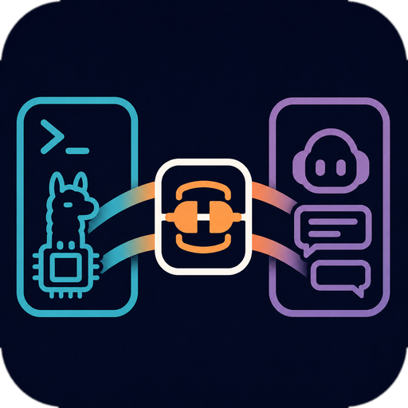

<p align="center"></p>

# SubHarness for VS Code

Formerly **AI Agent Bridge**. The repository moved from
`MrLordCat/ai-agent-bridge` to `MrLordCat/SubHarness`; old links redirect.

One agent chat in VS Code for your AI subscriptions and models: Codex with a
ChatGPT account, Claude, Cursor, Snowflake Coco, DeepSeek, custom APIs and
local llama.cpp servers. The chat runs its own tools with approval prompts,
hands work to subagents on cheaper models and keeps one working context when
you switch models. Quick Access puts connections, model settings and
diagnostics in one sidebar.

[](https://github.com/MrLordCat/SubHarness/releases/latest)
[](LICENSE)
[](https://github.com/MrLordCat/SubHarness/actions/workflows/ci.yml)

## The chat

The chat lives in the secondary side bar, next to the other agent chats: click
its **SubHarness** icon there. The first start opens it once. **SubHarness:
Open Chat in Editor** opens the same chat as an editor tab.

<p align="center"></p>

## Key features

- **Every subscription in one picker.** Codex with a ChatGPT account, Claude,
  Cursor, Snowflake Coco, DeepSeek, custom APIs and local llama.cpp servers.
  The picker groups models by provider, has search and stars, and shows each
  provider's 5-hour and weekly limits or its balance. Several ChatGPT and
  Claude accounts work side by side.
- **Limits that wait for you.** The limits chip shows the selected
  subscription's window; click it for every provider and its reset time. When
  the 5-hour Codex or Claude window stops an answer, the chat continues it by
  itself after the reset, also in a background chat and after a reload. With a
  second subscription the limit card offers **Continue on Codex 2** or
  **Continue on Claude 2**.
- **Subagents on cheaper models.** The agent hands bounded steps to cheaper
  models such as DeepSeek Flash or GPT-6-Luna: up to three in parallel, in the
  background while it keeps working, or kept open for follow-up tasks with
  their own context. Each report lists the files the subagent changed. A model
  whose limit is used up answers at once instead of starting.
- **Tools with approvals.** Files, search, terminals, project checks
  (`run_checks`), questions to you and a todo list, plus tools of other
  extensions and MCP servers when you enable them. Dangerous commands and
  changes outside the workspace ask first; **Always allow** approves that kind
  of action once, for every workspace.
- **Keep/Undo and diffs.** Every file a turn changed, subagents' edits
  included, waits for Keep or Undo. `changes_diff` gives the agent, or a
  reviewer subagent, the same changes as a diff.
- **One working context.** Switching models hands the conversation over,
  compacted when it is too long. A long chat cleans itself: over its budget
  (200,000 tokens by default, `llamacpp.chatContextBudget`), stale tool results
  and then older turns leave the model's context, and the full history stays
  in the chat. You do not need to start a new chat. The counter shows the
  prompt size against the window, **cache N%** the prompt-cache hit.
- **Chats in the background.** Several chats run at once. The header badge
  counts running, waiting and finished chats, and the system notifies you when
  a turn finishes or needs an approval while VS Code is not focused.
- **Shared memory.** Preferences, decisions and project facts the agent saves
  reach every model in later chats.
- **Everyday work:** attachments and pasted images, editing sent messages,
  queued messages while the agent works, chat history, and clickable file
  links in answers.
- **Diagnostics.** Session Quality and Live Report show usage, cache, context
  and slow steps.

| Model picker | Subscription limits | Context settings |
| :---: | :---: | :---: |
|  |  |  |

<p align="center"></p>

See [the chat guide](docs/CHAT.md).

## Install

Requires **VS Code 1.131+** on Windows x64 or Linux x64.

1. Download your platform's VSIX from [Releases](https://github.com/MrLordCat/SubHarness/releases/latest).
2. Open Extensions → **…** → **Install from VSIX…**, or use the CLI:

   ```sh
   # Windows x64
   code --install-extension llama-vscode-chat-v2.1.0-win32-x64.vsix
   # Linux x64
   code --install-extension llama-vscode-chat-v2.1.0-linux-x64.vsix
   ```

3. Run **Developer: Reload Window**.

### Updates

The extension checks the latest GitHub release every 5 hours (30 minutes after
a check that could not reach GitHub) and offers a newer version. Manual checks
ask GitHub at most once every 5 minutes. The **SubHarness** group in Quick
Access shows the installed version and the time of the last check. It also has
**Check for Updates**, **Install Update** and the **Automatic Updates** mode.
The setting `llamacpp.autoUpdate` is `notify` (default), `install` (download,
verify and install, then offer a reload) or `off` (manual checks only). The
package is downloaded only from this repository's releases and is installed
only when its SHA-256 digest matches the release. An older release never
replaces a newer local build.

Versions before 2.0.5 do not recognize the new repository name: install the
latest release once from [Releases](https://github.com/MrLordCat/SubHarness/releases/latest),
then updates arrive as before.

## Connect a model

Open **SubHarness: Open Sidebar**, enable the sources you need, configure
one below, then run **SubHarness: Refresh Models**. Select its model in the
chat's model picker.

| Source | Setup |
| --- | --- |
| Local llama.cpp / compatible server | Start the server, then run **Set Local Server URL** |
| Custom API, including OpenRouter, Cloudflare and Cursor | Quick Access → **Providers Manager** → add a profile and API key |
| DeepSeek | Run **Configure DeepSeek** and enter the API key |
| Codex with a ChatGPT account | Run **Sign In to Codex Subscription**; without the OpenAI extension or `codex` on PATH it offers to download the official Codex CLI |
| Claude | The VSIX includes its platform runtime; run **Sign In to Claude Subscription** (the Claude Code extension is not needed) |
| Snowflake Coco | Install the Snowflake extension, configure a CLI connection, then check Quick Access → **Coco** |

Command names above use the **SubHarness:** prefix. Accounts, model access
and server availability are required separately. API keys are stored in VS Code
SecretStorage; subscription sign-in is handled by the corresponding runtime.

### Two ChatGPT subscriptions in one window

Codex keeps every credential, thread and limit window under `CODEX_HOME`
(`~/.codex` by default). Adding an account gives it its own home and its own
Codex process, so both logins coexist.

Open Quick Access → **Codex** → **ChatGPT Accounts** and pick **Add Account…**:
enter a short id (`work`) and a name, and the window offers to reload. After the
reload the ChatGPT sign-in page opens by itself, and the new account is already
the active one. The same group holds everything afterwards:

- each account has **Sign In** (or **Sign In Again**) and **Sign Out** of its
  own; signing out of one keeps the other signed in;
- selecting an account makes it active for Quick Access and Codex status
  commands, and a Codex subagent tries it first;
- **Remove Account** takes an account out of the list; its `~/.codex-<id>`
  folder and login stay on disk, so adding the same id again restores them;
- threads, the last used model and the usage windows are tracked per account,
  so the Subscriptions tab reports each subscription separately.

Accounts can also be declared by hand in settings; the home defaults to
`~/.codex-<id>` and is created on first use:

```json
"llamacpp.codexAccounts": [
  { "id": "work", "label": "Work" }
]
```

Reload the window after editing the list by hand.

With two or more accounts, the chat model picker shows a group for each:
Codex 1 is the built-in `~/.codex` account, followed by Codex 2, Codex 3 and
so on in account-list order. Each group shows its own 5-hour and weekly limits,
and the quota chip follows the selected model's account. The built-in account
keeps the historical `codex::` model ids.

Subagents list each Codex model once, for example `GPT-6-Luna (Codex)`, and
pick the subscription when they start: the active account first, then the
others in account-list order, skipping an account whose 5-hour or weekly limit
is used up. An open subagent whose account runs out moves to the same model
of another account with its conversation. The subagent card names the account
it ran on (`GPT-6-Luna (Codex 2)`).

### Two Claude subscriptions in one window

Claude works the same way. Claude Code keeps the login, its state and the
sessions of an account under one config folder (`~/.claude` by default), so an
added account gets its own `CLAUDE_CONFIG_DIR` (`~/.claude-<id>`), and every
Claude process of that account runs with it. Quick Access → **Claude** →
**Add Claude Account…** asks for an id and a name, reloads the window and opens
the sign-in by itself; **Claude Accounts** then holds Sign In, Sign Out and
Remove for each account and selects the active one. By hand:

```json
"llamacpp.claudeAccounts": [
  { "id": "work", "label": "Work" }
]
```

The picker shows a group per account (Claude 1 is the built-in `~/.claude`
account, then Claude 2 …) with its own limits. Subagents list each Claude model
once, `Opus 5.5 (Claude)`, and start on the active account, then on the others,
skipping one whose limit is used up. Signing out of an added account leaves the
built-in login, and the Claude Code extension, alone.

When a limit stops an answer and another subscription of the same provider has
room, the limit card offers **Continue on Claude 2** (or **Codex 2**): the chat
takes that subscription's model and continues the answer like Retry.

### Snowflake Coco

Coco uses the CLI's credentials, so it may require a separate browser sign-in.
Its commands run in visible `Coco` terminals where you can type, interrupt or
close them. Images and reasoning choices depend on the connected runtime.
Coco keeps conversation sessions across requests and reloads and reports
native token and cache usage. See [Coco setup and behavior](docs/COCO.md).

## Documentation

- Chat: [the chat guide](docs/CHAT.md), [agent instructions](docs/AGENT-INSTRUCTIONS.md).
- Providers: [APIs](docs/API_PROVIDERS.md), [Codex](docs/CODEX_SUBSCRIPTION.md),
  [Claude](docs/CLAUDE_SUBSCRIPTION.md), [Cursor](docs/CURSOR.md), [Coco](docs/COCO.md).
- Long conversations: [shared context](docs/SHARED_CONTEXT.md),
  [tokens, reasoning and cache](docs/TOKENS_REASONING_CACHE.md), [memory](docs/MEMORY.md),
  [knowledge verification](docs/KNOWLEDGE_VERIFICATION.md),
  [diagnostics](docs/RELIABILITY_DIAGNOSTICS.md).
- Development: [architecture](docs/ARCHITECTURE.md), [Quick Access](docs/QUICK_ACCESS.md),
  [Debian desktop in Docker](docs/DEBIAN_GUI.md), [work plan](docs/WORK_PLAN_AGENTS.md).
- [Changelog](CHANGELOG.md) · [Release notes](docs/RELEASE_NOTES.md).

## Development

See [development and release workflow](docs/DEVELOPMENT_WORKFLOW.md) and
[provider contracts](docs/ARCHITECTURE.md#provider-contracts) for the current
maintenance contracts.

**Latest release: 2.1.0. Current build: 2.1.4.**

```sh
npm ci
npm run compile
npm run check:metadata
npm run lint
npm test              # 1713 extension-host tests passed on VS Code 1.143.1 in the 2.1.4 build
npm run package       # builds the local VSIX
code --install-extension ./llama-vscode-chat-2.1.4.vsix --force
```

The extension ID is `mrlordcat.llama-vscode-chat`; settings and commands retain
the `llamacpp.*` namespace. Release CI builds and tests Windows/Linux packages
separately. Tagging and publishing require an explicit release request; see
[AGENTS.md](AGENTS.md) and [the release script](scripts/stable-release.sh).

[MIT License](LICENSE)
