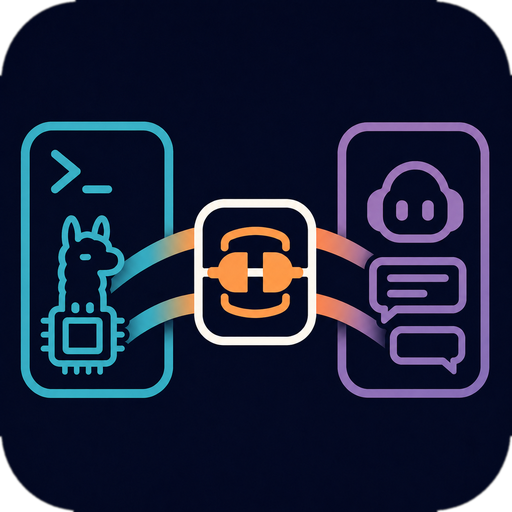
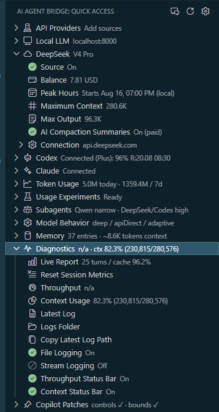
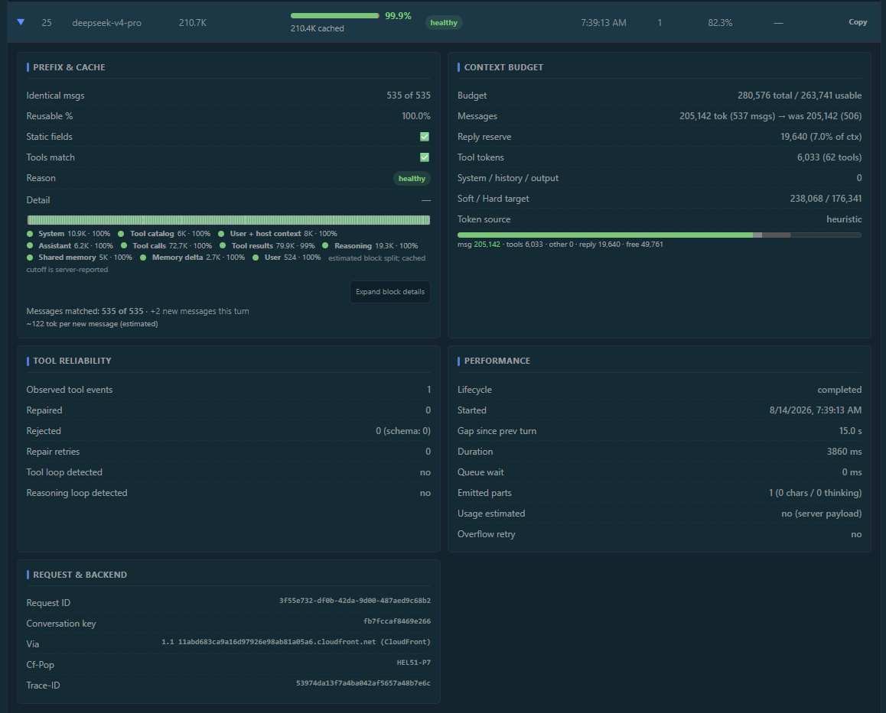
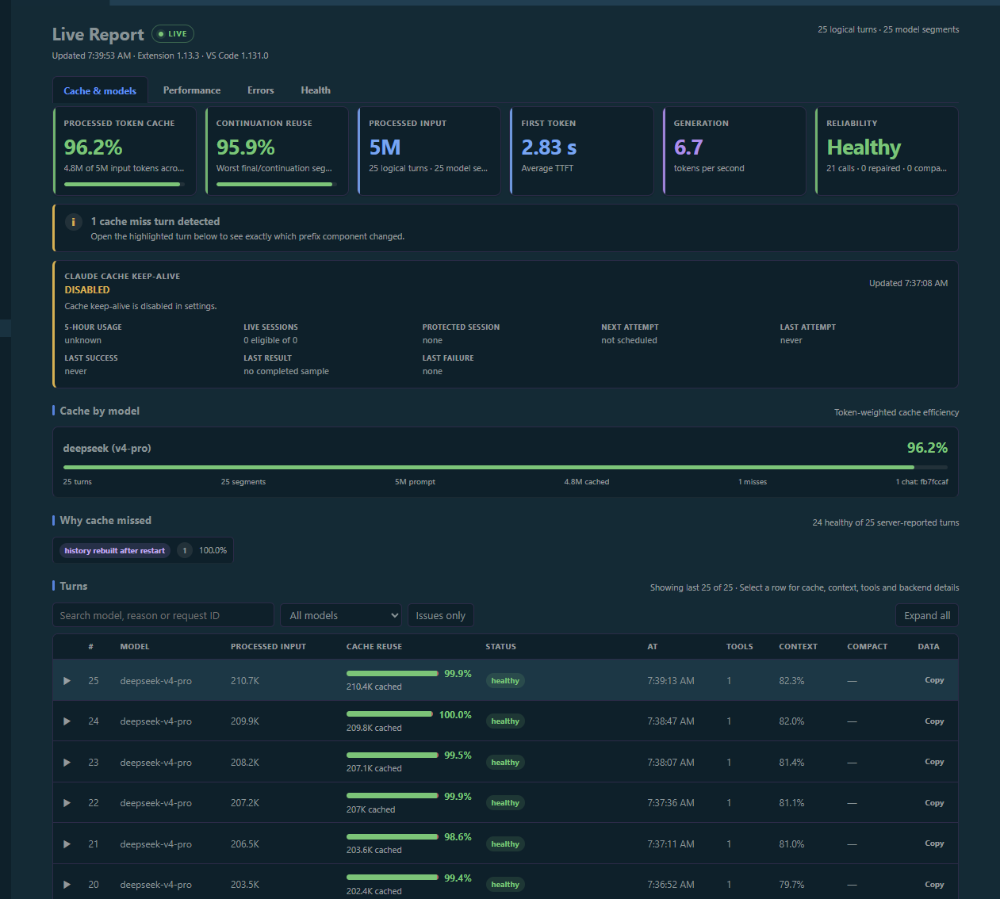

<p align="center"></p>

# AI Agent Bridge for VS Code

Use local models, custom APIs, DeepSeek, Codex, Claude and Snowflake Coco in
the normal VS Code Chat. Keep its file tools, terminal, approval prompts and
model picker. Quick Access puts connections, model settings and diagnostics
in one sidebar.

[](https://github.com/MrLordCat/ai-agent-bridge/releases/latest)
[](LICENSE)
[](https://github.com/MrLordCat/ai-agent-bridge/actions/workflows/ci.yml)

## Why patch Copilot?

Copilot supplies the Chat interface even when you select a model from this
extension. Some versions give connected models fewer controls or impose limits
that do not match the model. The patches change small parts of installed
Copilot/VS Code files to fix those limitations.

These are concrete examples on affected builds:

| What you want to do | Without the relevant patch | What the patch changes |
| --- | --- | --- |
| Use little reasoning for a typo fix, more for a difficult bug | The native **Thinking Effort** control can be missing | Exposes the control and forwards your choice to the model |
| Get a long code answer from a model that allows 32,768 output tokens | Copilot's wrapper reports a fixed limit of 8,192 tokens | Uses the model's advertised output limit; the model's own limits still apply |
| Continue a long conversation on a model with a large context window | Copilot can use an old smaller budget and summarize before the extension needs to | Uses the model's advertised window and lets the extension manage when and how to shorten history |
| Run tests that print thousands of log lines | Large tool results accumulate in saved chat history | Bounds saved tool output, while the live tool card keeps its result |
| Run another command after a timed-out command has finished | VS Code can leave the old terminal in the background and create another tab | Reuses the idle terminal instead of accumulating tabs |
| Use a connected model in the **Agents Window** on VS Code 1.131 | The reasoning picker is missing; some requests fail because VS Code returns the wrong response format | Adds the picker and fixes the response format; newer builds with native support skip this patch |

**Do you need them?** They are recommended for these controls and long agent
conversations. Basic model selection and chat can work without them. The
context-usage counter also works without a patch. They do not add model
intelligence, a subscription or access to paid models.

Compatible patches apply automatically when the extension starts. Reload after
the notification. Original files are backed up; unknown bundle layouts are
reported instead of patched. A VS Code update may require applying them again.

Quick Access → **Copilot Patches** has apply, status and restore actions.
`llamacpp.autoPatchCopilot` controls the Copilot patch;
`llamacpp.workbenchTerminalPatchEnabled` and
`llamacpp.agentHostThinkingPatchEnabled` control the other two.
Implementation details: [Patch v24](docs/COPILOT_PATCH.md).

## Install

Requires **VS Code 1.131+**, GitHub Copilot Chat and Windows x64 or Linux x64.

1. Download your platform's VSIX from [Releases](https://github.com/MrLordCat/ai-agent-bridge/releases/latest).
2. Open Extensions → **…** → **Install from VSIX…**, or use the CLI:

   ```sh
   # Windows x64
   code --install-extension llama-vscode-chat-v1.17.3-win32-x64.vsix
   # Linux x64
   code --install-extension llama-vscode-chat-v1.17.3-linux-x64.vsix
   ```

3. Run **Developer: Reload Window**, then reload again if a patch notification asks.

### Linux: system-owned VS Code

If the application files are read-only, the extension offers:

- **Prepare User VS Code (no root):** creates a writable copy in your home.
  Extensions are shared, but the copy has separate settings and accounts.
  Launch **AI Agent Bridge Code** or `~/.local/bin/code-ai-agent-bridge`.
- **Apply patches with administrator rights:** authorize changes to the current
  installation. If graphical authorization is unavailable, a terminal uses
  `sudo` or `su`. Enter your user's password for sudo, or root's password for su.

After a failed password entry, **Apply Patch** offers **Retry in Terminal** or
**Close Attempt** to start again. Reload after success. In SSH, WSL or Dev
Containers, prepare the desktop application on the computer displaying the window.

[Installation and recovery details](docs/COPILOT_PATCH.md#apply-and-restore) ·
[Manual Debian desktop in Docker](docs/DEBIAN_GUI.md)

## Connect a model

Open **AI Agent Bridge: Open Sidebar**, enable the sources you need, configure
one below, then run **AI Agent Bridge: Refresh Models**. Select its model in
the normal Chat picker.

| Source | Setup |
| --- | --- |
| Local llama.cpp / compatible server | Start the server, then run **Set Local Server URL** |
| Custom API, including OpenRouter and Cloudflare | Quick Access → **Providers Manager** → add a profile and API key |
| DeepSeek | Run **Configure DeepSeek** and enter the API key |
| Codex with a ChatGPT account | Install the official Codex runtime, then run **Sign In to Codex Subscription** |
| Claude | The VSIX includes its platform runtime; run **Sign In to Claude Subscription** |
| Snowflake Coco | Install the Snowflake extension, configure a CLI connection, then check Quick Access → **Coco** |

Command names above use the **AI Agent Bridge:** prefix. Accounts, model access
and server availability are required separately. API keys are stored in VS Code
SecretStorage; subscription sign-in is handled by the corresponding runtime.

Coco uses the CLI's credentials, so it may require a separate browser sign-in.
Its commands run in visible `Coco` terminals where you can type, interrupt or
close them. Images and reasoning choices depend on the connected runtime.
[Full Coco setup and behavior](docs/COCO.md).

Coco keeps conversation sessions across requests and reloads, restores available
Chat history when switching from Codex, and reports native token/cache usage.
See [Coco continuity and cache verification](docs/COCO_CONTINUITY.md).

## Useful features

- **Session Quality / Live Report:** inspect usage, cache, context and slow steps.
- **Continue Latest Codex/Claude Session in New Chat:** resume work with a clean Chat transcript.
- **Shared Memory:** save and retrieve project information across conversations.

<details>
<summary>Screenshots: Quick Access, Session Quality and Live Report</summary>

<p align="center">
<a href="assets/quick_panel.png"></a>
<a href="assets/turn_details.png"></a>
<a href="assets/Live_report.png"></a>
</p>

</details>

## Documentation

- Providers: [APIs](docs/API_PROVIDERS.md), [Codex](docs/CODEX_SUBSCRIPTION.md),
  [Claude](docs/CLAUDE_SUBSCRIPTION.md), [Coco](docs/COCO.md).
- Chat integration: [patches](docs/COPILOT_PATCH.md),
  [Agents Window](docs/AGENTS_WINDOW_INTEGRATION.md).
- Long conversations: [tokens, reasoning and cache](docs/TOKENS_REASONING_CACHE.md),
  [memory](docs/MEMORY.md), [diagnostics](docs/RELIABILITY_DIAGNOSTICS.md).
- Development: [architecture](docs/ARCHITECTURE.md), [agent tools](docs/AGENT_TOOLS_GUIDE.md),
  [audit](docs/AUDIT.md), [Debian verification](docs/DEBIAN_VERIFICATION.md).
- [Changelog](CHANGELOG.md) · [Release notes](docs/RELEASE_NOTES.md).

## Development

See [development and release workflow](docs/DEVELOPMENT_WORKFLOW.md),
[provider architecture](docs/PROVIDER_ARCHITECTURE.md), and
[Quick Access](docs/QUICK_ACCESS.md) for the current maintenance contracts.

**Stable release: 1.18.0. Current build: 1.18.2.**

```sh
npm ci
npm run compile
npm run check:metadata
npm run lint
npm test              # 702 extension-host tests in the current 1.18.2 build
npm run package       # builds the local VSIX
code --install-extension ./llama-vscode-chat-1.18.2.vsix --force
```

The extension ID is `mrlordcat.llama-vscode-chat`; settings and commands retain
the `llamacpp.*` namespace. Release CI builds and tests Windows/Linux packages
separately. Tagging and publishing require an explicit release request; see
[AGENTS.md](AGENTS.md) and [the release script](scripts/stable-release.sh).

[MIT License](LICENSE)
