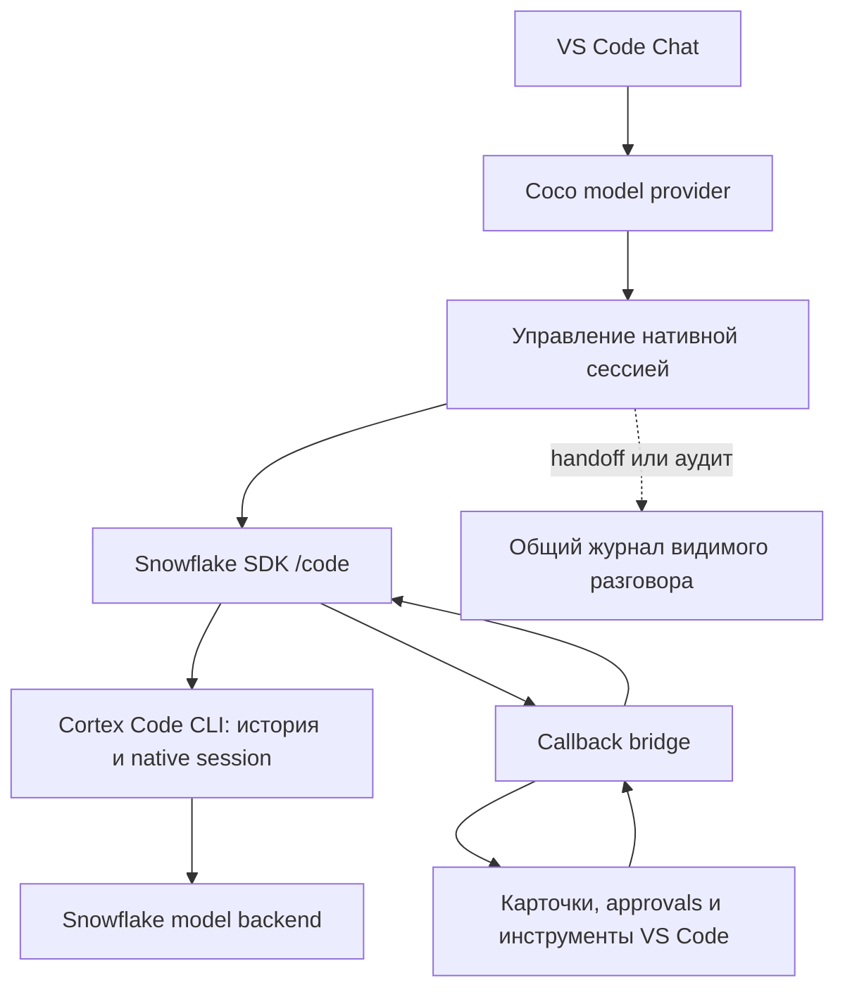

# Coco: переход к нативным сессиям в VS Code

Исследовано 2026-10-19. База: AI Agent Bridge 1.18.7, commit `78e309b`,
Windows x64, Snowflake extension 1.42.2, фактический Cortex Code CLI
`v0.26.1019`. Исходные выводы и план ниже описывают состояние до внедрения.
В 1.18.8 реализованы SDK-адаптер, долговечные привязки, одиночный handoff,
возврат подтверждённых результатов по native ID и ACP-изображения в той же
сессии. Актуальное поведение и проверки: [COCO.md](COCO.md).

В 1.18.9 удалена ошибочная проверка окна через число символов: за токеновые
лимиты и нативное сжатие отвечает CLI. Мост ограничивает только технический
размер кодированного содержимого (64 MiB), сохраняя превышение в архиве.

Уточнение 1.18.11: передача всего большого архива одним текстом также оказалась
ненадёжной. Теперь первый handoff подготавливается локально с приоритетом
текущего запроса, требований и недавних сообщений; исходник сохраняется целиком,
сокращение видно в Chat. Это рабочая эвристика, а не точный токеновый предел.
Реальная проверка на проблемном архиве и после native resume прошла.

## Вывод

Для обычного продолжения чата Coco не требуется заново получать собранную
историю. Нативная сессия уже существует в CLI. Наш мост должен надёжно хранить
её привязку и передавать только новый пользовательский ход и результаты
текущих инструментов.

Есть два технических пути: доработать нынешний ACP-клиент либо использовать
опубликованный Snowflake SDK **`@snowflake/cortex-agent-sdk/code`**.
Второй путь стоит взять в прототип: он предоставляет постоянный процесс,
`createSession`, `resume`, ветвление, пользовательские MCP-инструменты,
permission callbacks и системные инструкции. Его запуск и регистрация
инструмента проверены с установленным CLI без модельных запросов.

Замена транспорта сама по себе не исправит управление историей. Рекомендуется
сначала выделить управление нативной сессией из импорта истории, затем
подключить SDK как отдельный адаптер. ACP сохраняет смысл как совместимый
транспорт, но переключение между транспортами не должно автоматически
создавать новый чат и запускать платный импорт.

## Что означает «как Codex»

В нашем Codex также есть первоначальная сериализация видимого разговора.
Отличие не в полном отсутствии адаптации сообщений:

| Сценарий | Codex сейчас | Coco сейчас | Целевое поведение Coco |
|---|---|---|---|
| Новый чат | `thread/start`, первоначальный ввод | `session/new`, сериализованный ввод | Создать нативную сессию, передать начальные инструкции и новый запрос |
| Следующий ход | Тот же thread, `inputMode: user-turn` | Та же ACP-сессия при совпадении якорей | Тот же session ID, только новые записи |
| Reload | Сохранённая привязка, `thread/resume` | Привязка в Memento, `session/load` | Восстановить подтверждённую нативную сессию без импорта |
| Результат инструмента | Продолжение активного native turn | Продолжение ожидающего ACP-вызова | Вернуть результат в тот же native run через SDK/ACP |
| Прерывание | Есть отдельная логика interrupted threads и stale calls | Ожидающие обещания теряются, старая привязка забывается | Отдельное восстановление прерванного хода с проверкой выполненных действий |
| Чужой провайдер | Требуется согласовать новые сообщения | Общий журнал и текстовый перенос | Явный handoff, отделённый от обычного resume |

Источники: [Codex input modes](../src/codex/codex-provider.ts#L1143),
[thread start](../src/codex/codex-provider.ts#L1339),
[durable bindings](../src/codex/codex-provider.ts#L2382),
[thread resume](../src/codex/codex-provider.ts#L2415).

В обоих случаях VS Code вызывает модельного провайдера повторно после
инструмента. Поэтому слой, который соединяет этот вызов с продолжающимся
агентным runtime, всё равно нужен. SDK не заменяет карточки и approvals VS Code.

## Где нынешний мост создаёт ненадёжность

1. **Журнал входит в обязательный путь каждого запроса Coco.**
   `CompositeChatModelProvider` вызывает `ConversationHistory.begin` и
   подставляет восстановленные сообщения. Ошибка журнала блокирует Coco
   даже при доступной нативной сессии. Журнал нужен для handoff и точного
   перечитывания, но не должен владеть состоянием тёплой сессии.
2. **Восстановление зависит от полного префикса пользовательских якорей.**
   `acquire` требует совпадения сохранённых якорей и появления нового.
   Несовпадение ведёт к `history_changed` и удалению привязки. Канонизация
   уже скрывает часть изменений host-контекста, но перемотку и потерю
   отрисованных сообщений всё ещё приходится отличать по реконструкции истории.
3. **Последняя сохранённая привязка удаляется до начала работы.**
   `prepare` удаляет checkpoint перед initialize/load и предварительными
   проверками запроса; `finish(error)` также забывает сессию. Это намеренная
   защита от частично изменённой native history, но она теряет путь к
   восстановлению и при ошибках до инференса. Сам файл истории CLI этим не удаляется.
4. **Ошибка загрузки становится холодным стартом.**
   `load_failed` и `load_unsupported` переводят работу в новую сессию.
   Вместо восстановления старой привязки мост начинает новый перенос.
5. **Большой перенос — серия реальных модельных ходов.**
   Бюджет одного запроса ограничен сверху 500 000 символов даже для большого
   окна. `archive.prepare` разбивает всю историю, каждый фрагмент отправляется
   через `session/prompt` с просьбой ответить ACK, затем идёт отдельное
   продолжение. Это расходует токены и может вызвать сжатие уже при переносе.
6. **Прерванные инструменты не имеют долговечной корреляции.**
   `delegate` создаёт случайный `coco-*` ID и ожидающее Promise в памяти.
   После потери процесса вернуть результат в прежнее Promise невозможно.
   Старый результат заканчивается ошибкой «tool session is no longer active».
7. **Служебные инструкции попадают в пользовательскую историю.**
   Политика инструментов, путь к журналу и описание режима добавляются
   к очередному prompt. SDK предлагает отдельную установку system prompt,
   поэтому постоянные инструкции можно перестать повторять в каждом ходе.

Код: [общий журнал](../src/composite-provider.ts#L61),
[acquire/prepare](../src/coco/session-store.ts#L55),
[checkpoint/finish](../src/coco/session-store.ts#L121),
[импорт](../src/coco/coco-provider.ts#L327),
[разбиение](../src/coco/history-transfer.ts#L49),
[делегирование](../src/coco/turn-bridge.ts#L123).

## Подтверждённые возможности runtime

ACP `initialize` установленного CLI вернул protocol version 1 и:

- `loadSession: true`;
- `sessionCapabilities: { list: {}, close: {} }`;
- `promptCapabilities: { image: true }`.

`session/resume` и `session/fork` этим сервером не объявлены. Наличие таких
имён в поставляемой библиотеке ACP не доказывает реализацию сервером.
Для текущего транспорта подтверждённый путь восстановления — `session/load`.

Собственная панель Snowflake тоже запускает `cortex acp serve`, использует
`session/new`, `session/load` и `_meta.clientTools`. Следовательно, ACP сам по
себе не является обходным или ненативным транспортом. Нужен более надёжный
владелец сессии, независимо от выбора SDK.

В обработчике CLI также есть `_meta.sessionId` для создания с caller-provided
UUID и `session/list`. Это полезно для восстановления потерянной привязки,
но `_meta.sessionId` — расширение данного runtime, а не переносимая гарантия
ACP. Нельзя выбирать «последнюю сессию» только по cwd или похожему заголовку.

Локально проверены обработчики в поставляемых `extension.js` и `bin/cortex.exe`.
Их приватные классы не предлагается импортировать в наше расширение.

## SDK Snowflake: что найдено и проверено

Пакет `@snowflake/cortex-agent-sdk@0.0.2` опубликован 2026-10-13.
Maintainer в npm: `snowflakejs` с адресом `snowflake.com`.
Проверялся скачанный tarball без установки зависимости в проект.

Нужен именно entry point **`/code`**. Корневой `CortexAgentClient` — другой
уровень: REST API Cortex Agents и серверные conversations. Его подстановка
не сохранит автоматически локальные сессии и инструменты CLI.

| API `/code` | Значение для интеграции | Статус проверки |
|---|---|---|
| `createSession`, `send`, `stream`, `close` | Постоянный локальный агентный процесс | Запуск и control-initialize прошли |
| `resume`, `sessionId`, `continue` | Продолжение сессии CLI | Контракт и передача CLI-флагов проверены; содержательный resume не запускался |
| `forkSession`, `resumeSessionAt` | Ветвление от UUID сообщения | Контракт и реализация helper проверены; реальное ветвление не тестировалось |
| `createSdkMcpServer`, `tool` | Callback-инструменты в процессе расширения | Инертный сервер зарегистрирован, `mcp_status` вернул `connected` |
| `canUseTool`, `PreToolUse` hooks | Управление разрешениями и контроль действий | API и код маршрутизации изучены; реальное выполнение не тестировалось |
| `systemPrompt`, `appendSystemPrompt`, `settingSources` | Отдельные постоянные инструкции | Контракт и initialize payload проверены |
| `interrupt`, `setModel`, `setMcpServers` | Управление агентом | Наличие API проверено; смена SDK-handler-функций через `setMcpServers` не подтверждена |

Ограничения версии:

- Node.js требуется **>=22.22.0**. Нельзя ломать остальные провайдеры на
  поддерживаемом проектом Node 20: SDK надо загружать лениво и проверять runtime.
- SDK указывает минимум CLI 1.0.35, но **явно пропускает эту проверку для
  dev-версий `0.YY.MMDD`**. Это позволило стартовать с 0.26.1019, но не
  доказывает совместимость всех функций. Version guard не отключался.
- README называет preview v0.1.0, тогда как опубликованный пакет — 0.0.2.
  Версию и возможности следует брать из фактического пакета и wire-проверок.
- В 0.0.2 `handleMcpToolCall` вызывает `handler(args, {})`: callback не получает
  raw request ID или native tool-use ID. Для точного восстановления понадобится
  дополнительная проверенная корреляция с events/hooks либо улучшение SDK.
- JSON Schema VS Code и типизированные определения SDK требуют отдельного
  адаптера. Handler должен проверять вход; helper не делает runtime-валидацию.
- Ожидающее Promise не переживает завершение процесса и в SDK. Одного
  параметра `resume` недостаточно для восстановления незавершённого действия.

Проверки без инференса:

1. ACP initialize: возможности выше, `session/new/load/prompt` не разрешались проверкой.
2. SDK startup с `noMcp: true`: успешный control-initialize, `send` не вызывался.
3. SDK с инертным MCP-сервером: `connected`, 2 control requests, 0 вызовов
   инструментов, 0 отправленных user prompts. В процессе проверки `user`-сообщения
   блокировались до записи в stdin.
4. Первый MCP-вариант без явного исключения профилей/плагинов/skills не
   завершил initialize до остановки процесса через 25 секунд. Изолированный
   вариант с `only-explicit-profiles/plugins/skills` прошёл. Какой конкретно
   ambient-компонент вызвал задержку, не установлено. Не следует незаметно
   отключать проектные инструкции пользователя при будущей миграции.

Эти проверки не подтверждают качество ответа, cache hit, полный цикл approvals,
resume после реального хода или восстановление после падения.

## Рекомендуемая архитектура

Правила управления состоянием:

1. Связать стабильный conversation ID VS Code с native session ID, workspace,
   профилем/connection и совместимостью runtime. Сохранять привязку атомарно;
   Memento не должен оставаться единственной копией.
2. Отдельно хранить последний завершённый ход, UUID нативных сообщений,
   отправленный диапазон сообщений и состояние `inflight`. Ошибка до отправки
   запроса не должна уничтожать рабочую привязку.
3. Для warm/reload пути использовать native session и только новые сообщения.
   Общий журнал — sidecar для handoff и аудита. Его сбой не должен блокировать
   подтверждённое native resume. Журнал результатов действий остаётся обязательным
   там, где без него нельзя безопасно восстановить прерванный инструмент.
4. Не считать сохранённый session ID неизменяемым checkpoint. CLI мог записать
   частичный ход под тем же ID. До восстановления нужно проверить состояние;
   rollback/fork возможен только от подтверждённой нативной точки, если runtime
   действительно поддерживает это в данном сценарии.
5. SDK MCP handlers только делегируют вызов в Chat и ожидают результат.
   Выполнение файловых операций и команд остаётся в инструментах VS Code.
   Разрешения SDK не подменяют approvals редактора; внутренние действия CLI
   нужно запрещать и проверять отдельно, включая действия без permission prompt.
6. Стабилизировать system prompt, названия/порядок/схемы инструментов и конфигурацию.
   При смене каталога переиспользовать сессию, если это поддержано и проверено.
   Не обещать обновление in-process SDK handlers через API для внешних MCP-серверов.
7. После сбоя не повторять выполненный инструмент по совпадению имени и аргументов.
   Хранить receipts и native IDs; неизвестный результат требует reconciliation.
   Обещание exactly-once при потере подтверждения между двумя процессами некорректно.

Общий с Codex слой стоит выделять для привязок, состояний, receipts и метрик.
Протоколы и восстановление конкретных native histories должны оставаться
в адаптерах, а не превращаться в единый текстовый импорт для всех провайдеров.

## Переключение провайдеров и большой старый чат

У Codex и Coco разные нативные истории, системные префиксы и серверные кеши.
Перенос thread ID, отсутствие отправки старого контекста и гарантированный
cache hit при первом Codex -> Coco переходе технически не следуют из SDK.

- **Тот же Coco, та же нативная сессия:** resume без импорта.
- **Coco -> другой провайдер -> Coco:** согласовать только новые внешние ходы,
  не переигрывая то, что уже хранится в Coco.
- **Сессия потеряна:** найти по подтверждённой привязке/UUID; не выбирать
  произвольную последнюю сессию и не запускать молча новую.
- **Настоящий cold handoff:** отдельная политика переноса. Возможны краткая
  сводка плюс полный архив или однократная передача доступного контекста
  в пределах выбранного окна. Полный архив не равен уже прочитанной моделью
  истории; сводка не гарантирует сохранения каждой детали.

Автоматические ACK-запросы следует убрать из обычного пути восстановления.
Подтверждённого API для вставки произвольной assistant/tool history в Coco
без модельного хода в изученных интерфейсах нет. Редактирование внутренних
файлов conversations не является надёжной заменой такого API.

## Этапы и критерии перехода

1. **Управление состоянием:** отделить native continuation от handoff;
   сохранять last-completed/inflight и диагностировать причину нового session ID.
   Сначала исправить потерю привязки до инференса и неявный cold fallback.
2. **Изолированный SDK-прототип:** ленивый `/code`, фиксированные версии,
   явная конфигурация, существующий VS Code tool bridge. ACP можно оставить
   выбранным совместимым транспортом; сбой активного запроса не переключает
   транспорт с автоматическим повтором действий.
3. **Функциональные проверки:** новый ход, следующий ход, reload, изображение,
   несколько инструментов, обновление схем, отмена и падение процесса.
   Проверить native IDs/receipts и реальную поддержку fork до внедрения rollback.
4. **Handoff:** вынести текущие `ConversationHistory`/`history-transfer`
   из warm/resume пути; убрать серию ACK и ввести явный режим первичного переноса.
5. **Переход по результатам:** включать SDK по умолчанию после доказанного
   восстановления и отсутствия обхода approvals. Отдельный интерфейс чата
   или смена VS Code API для этого не требуются.

Критерии готовности:

- После reload загружается тот же подтверждённый native session ID;
  число повторно импортированных исторических сообщений — 0.
- Обычный пользовательский ход не вызывает скрытых ACK-prompts;
  tool continuation не создаёт нового пользовательского хода или сессии.
- Временная ошибка до инференса сохраняет прежнюю привязку.
- Падение после выполнения инструмента не приводит к его повторному выполнению.
- Изменение отрисованного host-контекста не создаёт ветку истории;
  настоящее редактирование старого запроса обрабатывается как ветвление.
- Диагностика отдельно показывает transport, session ID fingerprint,
  resume/new reason, переданные новые/исторические байты, imports, tool receipts
  и измеренный usage. Новая сессия не маскируется как успешный resume.
- Cache hit измеряется на реальном cold/warm/restored сценарии. Высокий процент
  не является гарантией: TTL, eviction, смена модели/префикса и native compaction
  остаются факторами backend. Счётчики SDK нельзя складывать по правилам ACP
  без проверки их семантики на wire-данных.

## Источники

- [ACP: Session Setup](https://agentclientprotocol.com/protocol/session-setup):
  `loadSession` capability и replay истории через `session/update`.
- [Snowflake CoCo CLI](https://docs.snowflake.com/en/user-guide/cortex-code/cortex-code-cli).
- [CoCo CLI reference](https://docs.snowflake.com/en/user-guide/cortex-code/cli-reference):
  headless stream-json и продолжение сессий.
- [SDK 0.0.2 в npm](https://www.npmjs.com/package/@snowflake/cortex-agent-sdk/v/0.0.2).
- [Проверенный tarball SDK](https://registry.npmjs.org/@snowflake/cortex-agent-sdk/-/cortex-agent-sdk-0.0.2.tgz):
  `dist/cortexcode/session.js`, `session.d.ts`, `mcp.js`, `sdk-types.d.ts`.
- [Текущее поведение Coco](COCO_CONTINUITY.md),
  [предыдущее исследование ограничений](COCO_CONTEXT_RESEARCH.md).